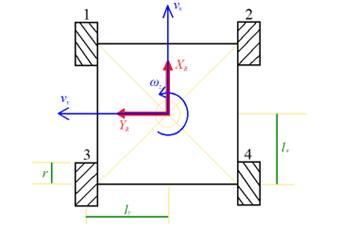

# 麥克納姆輪全向移動機器人<br>Mecanum-wheeled Omnidirectional Mobile Robot

本專案以 ROBOTIS 的嵌入式開發板 **OpenCR 1.0** 驅動四顆 **Dynamixel XH540-W150-R** 智能伺服馬達，搭配麥克納姆輪實現全向移動，並透過上位單板電腦 **NVIDIA Jetson™ TX2** 以 **Robot Operating System (ROS)** 進行整合控制。

## 目錄

- [系統架構](#系統架構)
- [硬體需求](#硬體需求)
- [專案結構](#專案結構)
- [運動學原理](#運動學原理)
  - [逆向運動學](#1-逆向運動學)
  - [編碼器與里程計](#2-編碼器與里程計)
- [ROS 介面](#ros-介面)
- [參數設定](#參數設定)
- [安裝與使用](#安裝與使用)

## 系統架構

```
 Jetson TX2 (ROS)  ──/cmd_vel, /cmd_clear──▶  OpenCR 1.0  ──TTL (Daisy chain)──▶  Dynamixel x4
                   ◀──────/odom, /tf────────   (逆向運動學 / 里程計)  ◀──── 編碼器位置 ────
```

## 硬體需求

| 元件 | 數量 | 用途 |
| --- | :---: | --- |
| OpenCR 1.0 | 1 | 逆向運動學計算、讀取編碼器並更新機器人姿態 |
| Dynamixel XH540-W150-R | 4 | 輪驅動伺服馬達 |
| 麥克納姆輪 (Mecanum wheel) | 4 | 全向輪 |
| NVIDIA Jetson™ TX2 | 1 | 上位機，發送運動命令 |

## 專案結構

```
Mecanum_OpenCR/
├── Mecanum/
│   ├── Mecanum.ino        # 主程式：系統初始化、ROS 通訊與主迴圈
│   ├── mecanum.cpp/.h     # 麥克納姆輪運動控制：逆向運動學、姿態與速度更新
│   ├── mecanum_ros.h      # ROS 節點、Subscriber / Publisher 與 TF 定義
│   └── motor_driver.cpp/.h# Dynamixel 速度寫入與編碼器位置讀取
└── figures/
    └── simplified_geometry_of_mobile_robot.png
```

## 運動學原理

<div align=center>



圖一、機器人坐標系下簡化幾何運動學模型

</div>

符號定義：

- $l_x$：前輪中心至後輪中心距離之一半； $l_y$：左右兩輪距離之一半； $r$：輪半徑。
- $v_x, v_y$：機器人沿 $X_R, Y_R$ 方向的線速度 $(m/s)$ ； $ω_z$：機器人繞 $Z_R$ 軸的角速度 $(rad/s)$ 。

### 1. 逆向運動學

給定 $v_x, v_y$ 及 $ω_z$ ，各輪線速度為：

$$
\left\lbrace\begin{matrix}
v_1 = v_x-v_y-(l_x+l_y)\omega _z \\
v_2 = v_x+v_y+(l_x+l_y)\omega _z \\
v_3 = v_x+v_y-(l_x+l_y)\omega _z \\
v_4 = v_x-v_y+(l_x+l_y)\omega _z \\
\end{matrix}\right.
$$

再由 $ω=\frac{v}{r}$ 換算各馬達轉速。實作見 `Mecanum::controlMecanum()`。

### 2. 編碼器與里程計

$$
\begin{bmatrix}
x(k) \\
y(k) \\
θ(k)
\end{bmatrix}
\=
\begin{bmatrix}
x(k-1) + \frac{r\sqrt{2}}{4} \left( \sin\left(\tilde{θ}(k-1) + \frac{\Deltaθ(k)}{2} \right) \Deltaθ_{1w} + \cos\left(\tilde{θ}(k-1) + \frac{\Deltaθ(k)}{2} \right) \Deltaθ_{2w} + \cos\left(\tilde{θ}(k-1) + \frac{\Deltaθ(k)}{2} \right) \Deltaθ_{3w} + \sin\left(\tilde{θ}(k-1) + \frac{\Deltaθ(k)}{2} \right) \Deltaθ_{4w} \right) \\
y(k-1) + \frac{r\sqrt{2}}{4} \left( -\cos\left(\tilde{θ}(k-1) + \frac{\Deltaθ(k)}{2} \right) \Deltaθ_{1w} + \sin\left(\tilde{θ}(k-1) + \frac{\Deltaθ(k)}{2} \right) \Deltaθ_{2w} + \sin\left(\tilde{θ}(k-1) + \frac{\Deltaθ(k)}{2} \right) \Deltaθ_{3w} - \cos\left(\tilde{θ}(k-1) + \frac{\Deltaθ(k)}{2} \right) \Deltaθ_{4w} \right) \\
θ(k-1) + \frac{r}{4(l_x + l_y)} \left( -\Deltaθ_{1w} + \Deltaθ_{2w} - \Deltaθ_{3w} + \Deltaθ_{4w} \right)
\end{bmatrix}\
$$

其中 $\Deltaθ(k)=\frac{r}{4(l_x + l_y)} \left( -\Deltaθ_{1w} + \Deltaθ_{2w} - \Deltaθ_{3w} + \Deltaθ_{4w} \right)$ ， $\tilde{θ}(k-1)=θ(k-1)+\frac{π}{4}$ 。

實作見 `Mecanum::updatePose()`：

1. 讀取各馬達在時間 $k$ 的編碼器刻度，與前一時刻 $k-1$ 相減得到刻度差。
2. 以 `TICK2RAD` 將刻度差轉為弧度差 $\Deltaθ_{iw}$ （ $2π/4096$ rad/tick）。
3. 代入上式更新機器人姿態 $(x, y, θ)$ 。

## ROS 介面

OpenCR 透過 rosserial（Baud rate 115200）與上位機通訊。

| 類型 | 名稱 | 訊息型別 | 說明 |
| --- | --- | --- | --- |
| Subscribe | `/cmd_vel` | `geometry_msgs/Twist` | 速度命令 $(v_x, v_y, ω_z)$ |
| Subscribe | `/cmd_clear` | `std_msgs/Bool` | 歸零里程計與速度命令 |
| Publish | `/odom` | `nav_msgs/Odometry` | 里程計資訊 |
| TF | `odom` → `base_footprint` | — | 座標轉換 |

## 參數設定

| 參數 | 值 | 檔案 |
| --- | --- | --- |
| 輪半徑 `WHEEL_RADIUS` | 0.05 m | `mecanum.h` |
| 半輪距 `HALF_WHEEL_TRACK` | 0.205 / 2 m | `mecanum.h` |
| 半軸距 `HALF_WHEEL_BASE` | 0.197 / 2 m | `mecanum.h` |
| Dynamixel Baud rate | 1,000,000 | `motor_driver.h` |
| Protocol | 2.0 | `motor_driver.h` |
| 控制頻率 / 更新頻率 | 30 Hz / 60 Hz | `motor_driver.h` |

馬達 ID：

| 位置 | ID |
| --- | :---: |
| 左前 | 0 |
| 右前 | 1 |
| 左後 | 2 |
| 右後 | 3 |

## 安裝與使用

1. **馬達設定**：使用 RoboPlus Manager 2.0 設定每顆馬達的 Baud rate 與 ID（見上表），並將右側（右前、右後）馬達設為 **Reverse mode**。
2. **馬達連接**：以菊鍊式（Daisy chain）將所有馬達串接至 OpenCR 的 TTL 接口。
3. **程式燒錄**：以 Arduino IDE 開啟 `Mecanum/Mecanum.ino` 並燒錄至 OpenCR。新增 OpenCR 開發板至 Arduino IDE 的方式請參考 [ROBOTIS e-Manual](https://emanual.robotis.com/docs/en/parts/controller/opencr10/)。
4. **啟動 ROS 通訊**：於 Jetson TX2 上執行
   ```bash
   rosrun rosserial_python serial_node.py _port:=/dev/ttyACM0 _baud:=115200
   ```
   之後即可發布 `/cmd_vel` 控制機器人，並訂閱 `/odom` 取得里程計資訊。
